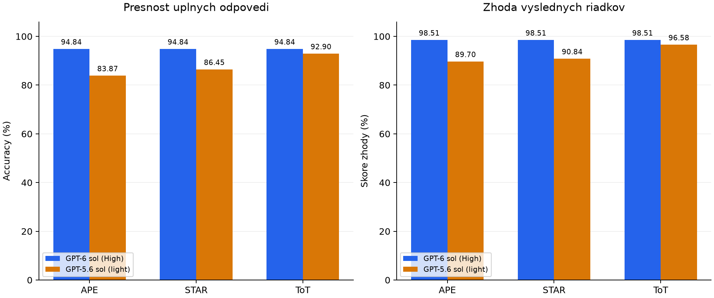
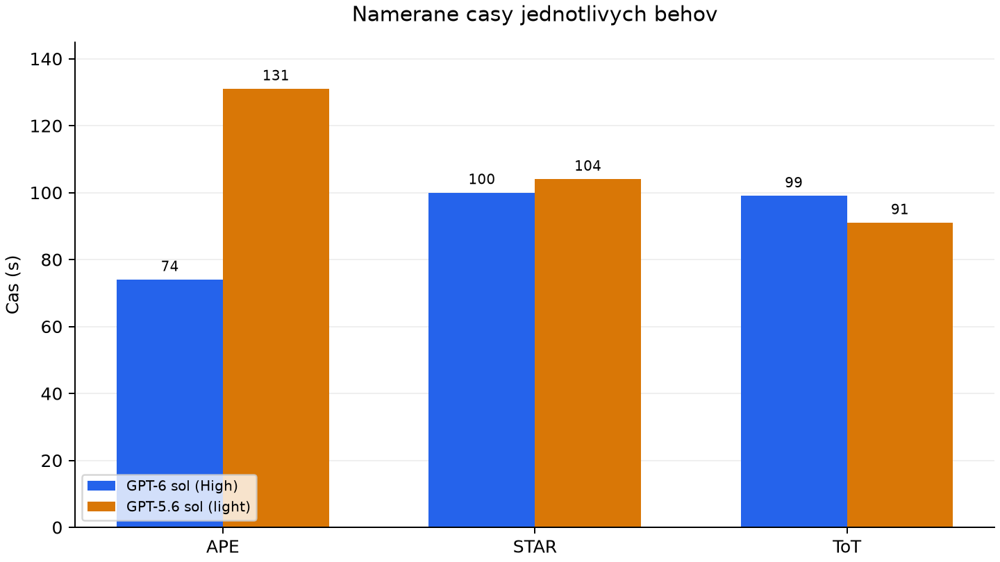

# Cviko 3.tyzden

## Task_1

### Framework 1: APE

- Zdroj: [https://frompting.com/frameworks/ape](https://frompting.com/frameworks/ape)
- Preco som ho vybrala a co od neho ocakavam: 
    - Ma jasnu a jednoduchu strukturu: Action, Purpose, Expectation
    - Dava pouzivatelovi jasne najavo co potrebuje a ako by to mal napisat aby bolo llm co najefektivnejsie
    - Ocakavam ze jasne zadane Action, Purpose a Expectation vrati ovela kvalitnejsiu odpoved.
 

```Prompt:
Action:
You are an SQL specialist. Convert every input question into a SQLite query using the restaurant database schema.

Input and access rules:
Read restaurants-schema.csv to identify the database tables and columns.
Load restaurants_dataset.csv with a CSV parser and extract only the question column. Do not display, inspect or use the result column.
Use only the input questions, the schema and the worked example in this prompt to generate SQL.
Do not read existing predictions, evaluation results or the contents of evaluate_retrieval_predictions.py.
Do not run the evaluator or adjust queries using expected results or evaluation feedback.
Only create or overwrite restaurants_dataset_predictions.csv. Do not modify any other files.

Purpose:
Retrieve the restaurants requested by each user question, so the saved queries can be used to answer those requests.

Expectation:
For each question, the SQL must return LOCATION.HOUSE_NUMBER and RESTAURANT.NAME, in that order.
Save restaurants_dataset_predictions.csv beside evaluate_retrieval_predictions.py, with columns question,predicted_sql.
Include one row per input question in the original order, preserving the exact question text and including one SQLite query.
Use valid CSV quoting. Store only SQL in predicted_sql, without explanations or Markdown formatting.
Save the predictions without evaluating them; evaluation will be performed separately.

Worked example:
Question: List all italian restaurants in example city.
SQL: SELECT L.HOUSE_NUMBER, R.NAME
     FROM RESTAURANT AS R
     JOIN LOCATION AS L ON L.RESTAURANT_ID = R.ID
     WHERE R.FOOD_TYPE = 'italian' AND R.CITY_NAME = 'example city';
```

### Framework 2: STAR

- Zdroj: [https://frompting.com/frameworks/star](https://frompting.com/frameworks/star)
- Preco som ho vybrala a co od neho ocakavam: 
    - Tak ako APE tiez ma jasnu strukturu: Situation-Task-Action-Result
    - Jasna struktura pomoze llm lepsie pochopit zadanie.
    - Pri rozdeleni na viacej casti ma zaujima ci bude mat lepsie vysledky ako APE
```Prompt:
You are an SQL specialist. Use the following completed case, organized as Situation, Task, Action, Result, as a demonstration for translating the input questions into SQL.
This is a STAR adaptation for SQL generation; STAR normally describes completed actions and their outcomes.

Situation:
In a fictional completed case, I worked with the restaurant database schema and received this request: List all italian restaurants in example city.

Task:
I needed to retrieve the matching restaurants, returning their house numbers and names.

Action:
I used RESTAURANT for restaurant names and food types, and LOCATION for house numbers. I joined LOCATION.RESTAURANT_ID to RESTAURANT.ID and added the requested food-type and city conditions.

Result:
I produced this SQL query:
SELECT L.HOUSE_NUMBER, R.NAME
     FROM RESTAURANT AS R
     JOIN LOCATION AS L ON L.RESTAURANT_ID = R.ID
     WHERE R.FOOD_TYPE = 'italian' AND R.CITY_NAME = 'example city';
The result of the case is the query itself; no execution result or measured success is claimed.

Apply the demonstrated structure to each new question:
Identify its situation and requested task, construct the SQL as your action, and use the completed query as its result. Adapt the conditions and tables to that question rather than copying the example's filters. Include only the resulting SQL in the CSV.

Input and access rules:
Read restaurants-schema.csv to identify the database tables and columns.
Load restaurants_dataset.csv with a CSV parser and extract only the question column. Do not display, inspect or use the result column.
Use only the input questions, the schema and the worked example in this prompt to generate SQL.
Do not read existing predictions, evaluation results or the contents of evaluate_retrieval_predictions.py.
Do not run the evaluator or adjust queries using expected results or evaluation feedback.
Only create or overwrite restaurants_dataset_predictions.csv. Do not modify any other files.

Required output:
For each question, the SQL must return LOCATION.HOUSE_NUMBER and RESTAURANT.NAME, in that order.
Save restaurants_dataset_predictions.csv beside evaluate_retrieval_predictions.py, with columns question,predicted_sql.
Include one row per input question in the original order, preserving the exact question text and including one SQLite query.
Use valid CSV quoting. Store only SQL in predicted_sql, without explanations or Markdown formatting.
Save the predictions without evaluating them; evaluation will be performed separately.
```

### Framework 3: ToT

- Zdroj: [https://frompting.com/frameworks/tot](https://frompting.com/frameworks/tot)
- Preco som ho vybrala a co od neho ocakavam: 
    - Vybrala som ho pretoze pracuje s viacerymi moznostami riesenia a porovnava ich
    - Predpokladam ze llm vyberie vhodnejsi SQL dotaz
    - Ma trochu iny pristup ako APE a STAR, preto ma zaujima ktory pristup bude pre tento use-case lepsi.
```Prompt:
You are an SQL specialist. Use a prompt-guided Tree of Thoughts search to construct one SQLite query for every input question.

Input and access rules:
Read restaurants-schema.csv to identify the database tables and columns.
Load restaurants_dataset.csv with a CSV parser and extract only the question column. Do not display, inspect or use the result column.
Use only the input questions, the schema and the worked example in this prompt to generate SQL.
Do not read existing predictions, evaluation results or the contents of evaluate_retrieval_predictions.py.
Do not run the evaluator or adjust queries using expected results or evaluation feedback.
Only create or overwrite restaurants_dataset_predictions.csv. Do not modify any other files.

Problem:
Translate each question into SQL that retrieves the requested restaurants using the available schema.

Branch:
For each question, generate three candidate partial query plans before choosing one. Each plan must specify the tables, relationships and selection conditions it would use. Use substantively different query constructions or plausible interpretations where the wording is ambiguous; differences in aliases or formatting do not count. Do not invent ambiguity in a clear question.

Evaluate:
Score each plan from 0 to 2 on each criterion: coverage of the question's requirements, consistency with the schema, and correctness of the proposed SQL semantics. A score of 0 means inconsistent, 1 means uncertain or incomplete, and 2 means consistent. Assess using only the question and schema, without executing queries or consulting expected answers.

Prune and expand:
Discard plans that conflict with the question or schema. Keep up to two of the highest-scoring plans and extend each into a complete SQLite query. Reassess the completed queries against the same criteria.

Backtrack:
If completing a plan reveals a missing condition, invalid relationship or contradiction, return to that plan's previous decision and try another construction. Allow up to two backtracking attempts per question. If only one sound construction exists, use it instead of inventing alternatives.

Select:
Choose the completed query with the strongest assessment. If equally valid candidates remain, select the simpler one. Keep only the selected SQL in the output; do not include candidate plans or scores in the CSV.

Required output:
For each question, the SQL must return LOCATION.HOUSE_NUMBER and RESTAURANT.NAME, in that order.
Save restaurants_dataset_predictions.csv beside evaluate_retrieval_predictions.py, with columns question,predicted_sql.
Include one row per input question in the original order, preserving the exact question text and including one SQLite query.
Use valid CSV quoting. Store only SQL in predicted_sql, without explanations or Markdown formatting.
Save the predictions without evaluating them; evaluation will be performed separately.

Worked example:
Question: List all italian restaurants in example city.
SQL: SELECT L.HOUSE_NUMBER, R.NAME
     FROM RESTAURANT AS R
     JOIN LOCATION AS L ON L.RESTAURANT_ID = R.ID
     WHERE R.FOOD_TYPE = 'italian' AND R.CITY_NAME = 'example city';
```

## Task_2

Oba modely riesili rovnakych 155 otazok pomocou promptov APE, STAR a ToT. Skript vykonal vygenerovane SQL dotazy a porovnal ich vysledky s ocakavanymi.

### 2.1 GPT-6 sol (High)

| Prompt | Spravne odpovede | Accuracy (%) | Cas |
| --- | --- | --- | --- |
| APE | 147/155 | 94.84 | 1m 14s |
| STAR | 147/155 | 94.84 | 1m 40s |
| ToT | 147/155 | 94.84 | 1m 39s |

**Popis vysledkov:** Vsetky tri prompty dosiahli rovnaku presnost 94.84 %, teda 147 spravnych odpovedi zo 155. Najrychlejsi bol APE. STAR a ToT trvali dlhsie a mali rovnaku presnost.

**Subory s vystupmi:** [APE](Task_2/data/APE_predictions.csv), [STAR](Task_2/data/STAR_predictions.csv), [ToT](Task_2/data/ToT_predictions.csv).

### 2.2 GPT-5.6 sol (light)

| Prompt | Spravne odpovede | Accuracy (%) | Cas |
| --- | --- | --- | --- |
| APE | 130/155 | 83.87 | 2m 11s |
| STAR | 134/155 | 86.45 | 1m 44s |
| ToT | 144/155 | 92.90 | 1m 31s |

**Popis vysledkov:** Najpresnejsi aj najrychlejsi bol ToT, nasledoval STAR a potom APE. ToT vyriesil spravne 144 otazok, STAR 134 a APE 130 zo 155. SQL dotazy fungovali, ale niektore vynechali podmienku alebo vratili nespravny pocet restauracii.

**Subory s vystupmi:** [APE](Task_2/data/APE_predictions_5.6.csv), [STAR](Task_2/data/STAR_predictions_5.6.csv), [ToT](Task_2/data/ToT_predictions_5.6.csv).

### 2.3 Porovnanie modelov

GPT-6 s High dosiahol vyssiu presnost pri vsetkych promptoch. GPT-5.6 s light mal najlepsi vysledok pri ToT, kde sa najviac priblizil GPT-6. GPT-6 bol rychlejsi pri APE a STAR, pri ToT bol rychlejsi GPT-5.6. Menil sa model aj nastavenie thinking, preto sa ich samostatny vplyv neda urcit.

## Task_3

**Metrika:** Skore zhody vysledkov. Porovnavam vratene a ocakavane riadky podla cisla domu a nazvu restauracie.

Zvolila som ju, pretoze hodnoti aj ciastocne spravne odpovede a zohladnuje chybajuce aj navyse vratene riadky. Doplna accuracy, ktora uznava iba uplne spravny vysledok.

`Skore = 2 * pocet zhodnych riadkov / (pocet ocakavanych riadkov + pocet vratenych riadkov)`

Napriklad dve spravne restauracie z troch ocakavanych, bez dalsich vysledkov, daju skore 80 %. Ak su oba vysledky prazdne, skore je 100 %; ak je prazdny iba jeden alebo SQL nefunguje, je 0 %. V tabulke je priemer zo 155 otazok z Task_2.

**Kod:** [calculate_result_score.py](Task_3/calculate_result_score.py)

| Model | Prompt | Skore zhody vysledkov (%) |
| --- | --- | --- |
| GPT-6 sol (High) | APE | 98.51 |
| GPT-6 sol (High) | STAR | 98.51 |
| GPT-6 sol (High) | ToT | 98.51 |
| GPT-5.6 sol (light) | APE | 89.70 |
| GPT-5.6 sol (light) | STAR | 90.84 |
| GPT-5.6 sol (light) | ToT | 96.58 |

**Porovnanie:** GPT-6 dosiahol pri vsetkych promptoch rovnake skore. Pri GPT-5.6 bol najlepsi ToT, potom STAR a APE. Skore je vyssie ako accuracy, pretoze zapocitava aj ciastocne spravne vysledky.

**Vysledky:** [Suhrn](Task_3/metric_results.csv), [jednotlive otazky](Task_3/metric_scores.csv).

## Task_4

### 4.1 Porovnanie vysledkov

| Model | Prompt | Accuracy (%) | Skore zhody (%) | Cas (s) |
| --- | --- | --- | --- | --- |
| GPT-6 sol (High) | APE | 94.84 | 98.51 | 74 |
| GPT-6 sol (High) | STAR | 94.84 | 98.51 | 100 |
| GPT-6 sol (High) | ToT | 94.84 | 98.51 | 99 |
| GPT-5.6 sol (light) | APE | 83.87 | 89.70 | 131 |
| GPT-5.6 sol (light) | STAR | 86.45 | 90.84 | 104 |
| GPT-5.6 sol (light) | ToT | 92.90 | 96.58 | 91 |



GPT-6 dosiahol pri vsetkych promptoch rovnake hodnoty oboch metrik. Pri GPT-5.6 bol najlepsi ToT, potom STAR a APE. ToT mal oproti APE vyssiu accuracy o 9.03 percentualneho bodu a skore zhody o 6.88 percentualneho bodu.

Skore zhody je vyssie ako accuracy, pretoze uznava aj ciastocne spravne vysledky. Napriklad pri otazke na restauracie v alameda vratil GPT-6 vsetkych 62 ocakavanych riadkov a jeden navyse. Accuracy oznaci otazku za nespravnu, ale skore zhody je 99.20 %.



Pri GPT-6 bol najrychlejsi APE, pri GPT-5.6 ToT. Najlepsi namerany cas celkovo mal GPT-6 s APE, 74 sekund. Casy porovnavam iba opisne, pretoze pre kazdu kombinaciu mam jeden beh.

### 4.2 Statisticka vyznamnost

Pri GPT-6 mali vsetky prompty rovnaku uspesnost. Pri GPT-5.6 statisticke overenie ukazalo, ze ToT bol lepsi ako APE v oboch metrikach. Pri ostatnych porovnaniach sa statisticky vyznamny rozdiel nepreukazal.

Kazdu kombinaciu som spustila iba raz a otazky obsahuju podobne zadania, preto statisticke vysledky beriem ako orientacne pre tento dataset.

**Overenie:** [Vypocet](Task_4/analyze_results.py) a [vysledky testov](Task_4/statistical_tests.csv).

### 4.3 Preco vznikli rozdiely

- **Prompty:** APE zadava ulohu priamo, STAR pouziva vyrieseny priklad a ToT ziada porovnat viac moznosti. Pri GPT-5.6 mohol podrobnejsi ToT postup pomoct zachytit podmienky otazok. Je to mozne vysvetlenie, samotne CSV nepotvrdzuje, ze agent vsetky kroky ToT skutocne vykonal.
- **Model:** GPT-6 s High bol presnejsi pri vsetkych promptoch. Pri GPT-5.6 s light sa castejsie objavili vynechane podmienky alebo nespravne spracovany typ kuchyne. Menil sa model aj thinking, preto ich samostatny vplyv neviem oddelit.
- **Kodovaci agent:** Agent spracoval CSV a vytvoril SQL. Spolocny priklad pouziva R.CITY_NAME, co mohlo podporit rovnaku volbu aj v dalsich dotazoch. Vsetky tri GPT-6 vystupy mali sedem chyb sposobenych pouzitim mesta z RESTAURANT namiesto LOCATION; pri kontrole v pamati zmena tejto podmienky odstranila tychto sedem nezhod. Ulozene predikcie som nemenila.

Konkretnym prikladom chyby GPT-5.6 s APE je LIMIT 1 pri hladani restauracii v regione monterey: vratil jednu restauraciu namiesto 63. Pri STAR v otazke na hunan kuchynu v bay area chybala podmienka FOOD_TYPE, takze vratil 849 riadkov namiesto jedneho. ToT mal menej chyb, ale niekedy zahrnul nesuvisiaci pribeh do hodnoty FOOD_TYPE.

Hodnotenie ovplyvnuje aj dataset: 43 otazok ma prazdny ocakavany vysledok a otazka "What is the lifes greates illusion?" ocakava 2696 riadkov, hoci nesuvisi s restauraciami.

**Vypocet a grafy:** [analyze_results.py](Task_4/analyze_results.py), [potrebne kniznice](Task_4/requirements.txt).

**Data analyzy:** [Spolocne vysledky](Task_4/comparison_results.csv), [statisticke testy](Task_4/statistical_tests.csv).
