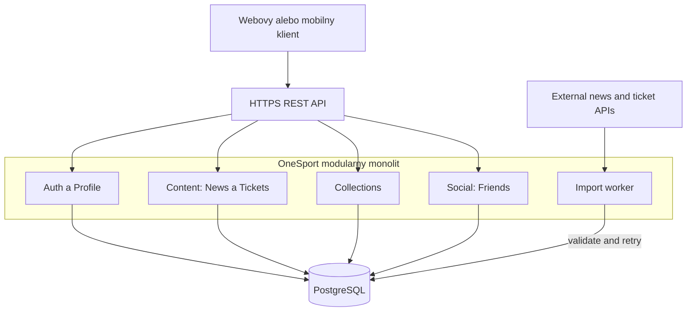
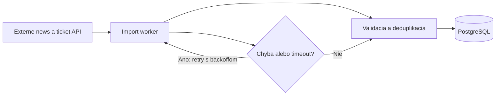

# ADR-001: Modulárny monolit pre OneSport

- **Stav:** Accepted
- **Dátum:** 2026-10-31
- **Rozhodnutie:** OneSport bude v prvej verzii implementovaný ako modulárny
  monolit s REST API, PostgreSQL databázou a samostatným workerom na import
  externých dát.

## Kontext

OneSport je platforma pre aktuálne športové správy, informácie o športových
eventoch a dostupné vstupenky. Používateľské požiadavky zahŕňajú:

- registráciu, prihlasovanie, odhlasovanie a správu profilu;
- zmenu e-mailu a hesla a vymazanie účtu;
- zobrazovanie a filtrovanie správ a vstupeniek podľa krajiny;
- ukladanie a odstraňovanie obľúbených správ a vstupeniek;
- vyhľadávanie používateľov podľa e-mailu;
- odosielanie, prijímanie, odmietanie a mazanie žiadostí o priateľstvo;
- zobrazovanie a správu zoznamu priateľov.

Systém bude pracovať s osobnými údajmi a s viacerými vzájomne prepojenými
entitami. Najmä prijatie žiadosti o priateľstvo a vytvorenie priateľstva má byť
konzistentná operácia. Požiadavky zároveň neuvádzajú extrémnu návštevnosť,
viacero nezávislých vývojových tímov ani potrebu nezávislého škálovania každej
časti systému.

## Zvažované alternatívy

### 1. Modulárny monolit

Jedna nasadzovaná backendová aplikácia bude vnútorne rozdelená na moduly.
Klient bude komunikovať cez HTTPS REST API a moduly budú používať spoločnú
relačnú databázu PostgreSQL.

**Výhody:**

- jednoduchší vývoj, deployment a lokálne spustenie;
- PostgreSQL poskytuje cudzie kľúče, JOIN operácie a transakcie;
- jednoduchšie integračné testovanie a centralizované logy;
- nižšia počiatočná cena;
- jasné moduly môžu neskôr slúžiť ako základ pre vyčlenenie služby.

**Nevýhody:**

- pri zaťažení jedného modulu sa zvyčajne škáluje celý backend;
- chyba v jednom module môže ovplyvniť celý deployment;
- spoločná databáza môže byť výkonnostným úzkym miestom;
- nedodržané hranice môžu viesť k silne prepojenému kódu.

### 2. Mikroslužby

OneSport by bol rozdelený na samostatné služby, napríklad Identity, Content,
Collection a Social service. Každá služba by vlastnila svoje dáta a služby by
komunikovali cez HTTP/gRPC a message broker.

**Výhody:**

- nezávislé škálovanie a nasadzovanie služieb;
- jasné vlastníctvo dát a zodpovedností;
- lepšia izolácia porúch medzi doménami;
- vhodné riešenie pre veľký tím alebo vysokú návštevnosť.

**Nevýhody:**

- vyššia náročnosť deploymentu, monitoringu a lokálneho vývoja;
- sieťové volania pridávajú latenciu a nové body zlyhania;
- operácie naprieč službami nemajú jednoduchú spoločnú transakciu;
- potrebné sú idempotentné eventy, retry mechanizmy, tracing a dead-letter
  queue;
- vymazanie účtu alebo prijatie priateľstva by vyžadovalo distribuovaný
  workflow, napríklad Saga pattern.

### 3. Serverless/event-driven architektúra

Endpointy by obsluhovali cloudové funkcie, pričom autentifikáciu, fronty,
plánované úlohy a databázu by poskytovali managed cloud služby. Na ukladanie
kolekcií a sociálnych dát by sa mohla použiť NoSQL databáza.

**Výhody:**

- automatické škálovanie podľa počtu požiadaviek;
- vhodné pre nepravidelné špičky počas športových udalostí;
- menej vlastnej serverovej infraštruktúry;
- fronty uľahčujú retry importov a asynchrónne spracovanie.

**Nevýhody:**

- zložitejšie modelovanie vzťahov medzi používateľmi a priateľstvami;
- eventual consistency môže používateľovi dočasne zobrazovať zastarané dáta;
- cold starts, timeouty a limity funkcií;
- vendor lock-in a potenciálne nepredvídateľné náklady;
- náročnejšie lokálne testovanie a debugging distribuovaného flow.

## Rozhodovacie kritériá

Alternatívy sa posudzujú podľa konkrétnych potrieb OneSport: používateľské
účty, kolekcie, priateľstvá a import externých správ a vstupeniek. Kritériá sú
zoradené podľa priority pre prvú verziu: kritická, vysoká, stredná a nižšia.

1. **Konzistentnosť a integrita dát (kritická):** operácie s priateľstvami,
  kolekciami a účtom nesmú vytvárať protichodné alebo duplicitné záznamy.
2. **Bezpečnosť a ochrana osobných údajov (kritická):** systém musí spoľahlivo
  overovať autentifikáciu, vlastníctvo zdrojov a vymazanie používateľských dát.
3. **Zložitosť vývoja a prevádzky (vysoká):** riešenie má byť zvládnuteľné pre
  malý tím a nemá vyžadovať zbytočne rozsiahlu infraštruktúru.
4. **Odolnosť voči externým závislostiam (vysoká):** výpadok alebo pomalý import
  správ a vstupeniek nesmie zablokovať prihlasovanie a existujúci obsah.
5. **Jednoduchosť lokálneho testovania (vysoká):** tím musí vedieť systém
  spustiť a overiť bez neprimerane zložitého distribuovaného prostredia.
6. **Nezávislé škálovanie častí systému (stredná):** najviac zaťažené časti by
  mali mať možnosť samostatného rastu, hoci extrémna návštevnosť nie je
  požiadavkou.
7. **Izolácia porúch medzi doménami (stredná):** zlyhanie jednej časti by malo
  čo najmenej ovplyvniť ostatné časti systému.
8. **Náklady v prvej verzii (stredná):** infraštruktúra a prevádzka majú byť
  primerané rozsahu projektu.
9. **Budúca rozšíriteľnosť (stredná):** riešenie má umožniť neskoršie
   vyčlenenie modulu alebo zmenu architektúry bez úplného prepísania systému.
10. **Nezávislé nasadzovanie modulov (nižšia):** samostatné deploymenty sú
  užitočné, ale pre prvú verziu nie sú nevyhnutné.

## Porovnanie alternatív podľa kritérií

Hodnotenie je relatívne pre prvú verziu OneSport. Pri kritériách náročnosti a
nákladov znamená **nízka** priaznivejší výsledok, pri ostatných kritériách
znamená **vysoká** priaznivejší výsledok.

| Kritérium | Modulárny monolit | Mikroslužby | Serverless/event-driven |
|---|---|---|---|
| Zložitosť vývoja a prevádzky | Nízka | Vysoká | Stredná až vysoká |
| Konzistentnosť a integrita dát | Vysoká | Stredná až nízka | Stredná až nízka |
| Bezpečnosť a ochrana osobných údajov | Vysoká | Vysoká | Stredná |
| Odolnosť voči externým závislostiam | Stredná až vysoká | Vysoká | Vysoká |
| Nezávislé škálovanie častí systému | Nízke | Vysoké | Vysoké |
| Izolácia porúch medzi doménami | Stredná | Vysoká | Vysoká |
| Náklady v prvej verzii | Nízke | Vysoké | Nízke až stredné |
| Jednoduchosť lokálneho testovania | Vysoká | Nízka | Nízka až stredná |
| Nezávislé nasadzovanie modulov | Nízke | Vysoké | Vysoké |
| Budúca rozšíriteľnosť | Stredná až vysoká | Vysoká | Vysoká |

Tabuľka ukazuje hlavný kompromis: mikroslužby a serverless poskytujú lepšie
škálovanie a izoláciu, ale za cenu distribuovanej konzistentnosti a vyššej
prevádzkovej náročnosti. Modulárny monolit má slabšie nezávislé škálovanie, no
pri aktuálnom rozsahu poskytuje najlepší pomer jednoduchosti, konzistentnosti a
nákladov.

## Rozhodnutie

Vyberáme **modulárny monolit s REST API a PostgreSQL**. Táto možnosť najlepšie
zodpovedá súčasnému rozsahu projektu, malému alebo začínajúcemu tímu a potrebe
konzistentne spracovať používateľské, kolekčné a sociálne operácie.

Externý import správ a vstupeniek bude oddelený do background workera. Worker
bude mať timeouty, retry s backoffom, validáciu vstupu a ochranu pred
duplicitným importom. Výpadok externého zdroja tak nebude blokovať login ani
zobrazenie už uložených dát.

## Navrhovaná štruktúra

### Tok importu externych dat

### Moduly

- **Auth/Profile:** registrácia, login, logout, relácie, zmena údajov profilu a
  vymazanie účtu.
- **Content:** správy, udalosti, vstupenky, filtrovanie podľa krajiny,
  stránkovanie a stav dostupnosti.
- **Collections:** obľúbené správy a uložené vstupenky konkrétneho používateľa.
- **Social:** hľadanie používateľov, friend requesty a zoznam priateľov.
- **Import worker:** pravidelné načítanie, validácia a deduplikácia externého
  obsahu.

Moduly budú komunikovať cez verejné aplikačné rozhrania. Modul nesmie priamo
používať interné triedy ani tabuľky iného modulu bez definovaného rozhrania.

## Mapovanie požiadaviek na architektúru

Nasledujúca tabuľka mapuje user stories z `data/OneSport.txt` na zodpovedný
modul a rozhodnutie, ktoré ich podporuje.

| User stories | Požiadavka | Modul | Architektonická realizácia |
|---|---|---|---|
| 1-3 | Registrácia, login a logout | Auth/Profile | REST endpointy, hash hesiel a expirované relácie |
| 4-6 | Profil, zmena e-mailu alebo hesla, vymazanie účtu | Auth/Profile | Autorizácia vlastníka, transakčné vymazanie a invalidácia relácií |
| 7-8 | Zobrazenie a filtrovanie športových správ podľa krajiny | Content | PostgreSQL indexy, serverové filtrovanie a stránkovanie |
| 9-10 | Pridanie a odstránenie obľúbenej správy | Collections | `saved_news`, unikátne obmedzenie a kontrola vlastníctva |
| 11-12 | Zobrazenie a filtrovanie dostupných vstupeniek | Content | `events` a `tickets`, indexy a aktuálny stav dostupnosti |
| 13-15 | Uloženie, odstránenie a vymazanie všetkých lístkov | Collections | `saved_tickets`, idempotentné operácie a transakcie |
| 16, 19 | Vyhľadanie používateľa a odoslanie žiadosti | Social | Vyhľadávanie podľa indexovaného e-mailu a autorizovaný endpoint |
| 17, 23-24 | Prijatie, odmietnutie a vymazanie žiadosti | Social | Stavový model, unikátne obmedzenia a databázová transakcia |
| 18, 22 | Zobrazenie a odstránenie priateľov | Social | `friendships`, kontrola účastníka vzťahu a transakčné zmeny |
| 20-21 | Zobrazenie uložených správ a vstupeniek | Collections | Stránkované dotazy s overením vlastníctva kolekcie |

### Nefunkčné požiadavky

| Požiadavka | Architektonická odpoveď |
|---|---|
| Bezpečnosť osobných údajov | HTTPS, hash hesiel, expirácia relácií a autorizácia vlastníctva |
| Konzistentnosť a idempotencia | PostgreSQL transakcie, cudzie kľúče a unikátne obmedzenia |
| Výkon filtrovania | Serverové filtrovanie, stránkovanie a indexy podľa krajiny, dátumu a e-mailu |
| Odolnosť importu | Samostatný worker, timeouty, retry s backoffom, deduplikácia a evidencia zlyhaní |
| Testovateľnosť | Modulárne hranice, unit/integration/API testy a centralizované logy |

### Nefunkčné predpoklady

Tieto predpoklady nie sú priamo uvedené v user stories, ale ovplyvňujú platnosť
tohto architektonického rozhodnutia:

| Predpoklad | Dôsledok pre návrh | Signál na prehodnotenie |
|---|---|---|
| Prvá verzia nemá extrémnu návštevnosť ani veľké špičky | Jeden backend a PostgreSQL sú postačujúce | Dlhodobé preťaženie alebo prekročenie kapacity jedného deploymentu |
| Systém bude vyvíjať malý tím | Uprednostní sa jednoduchý deployment a lokálne spustenie | Viac tímov potrebuje nezávislé vlastníctvo a nasadzovanie domén |
| Priateľstvá a kolekcie vyžadujú okamžitú konzistentnosť | Použijú sa relačné transakcie a unikátne obmedzenia | Požiadavka na distribuované alebo offline zápisy |
| Externé zdroje poskytujú dáta cez API, ale môžu byť dočasne nedostupné | Import prebieha asynchrónne cez worker s retry mechanizmom | Zmena formátu, SLA alebo úplná nedostupnosť poskytovateľa |
| Aplikácia bude nasadená s dostupnou PostgreSQL a persistentným workerom | Nie je potrebná NoSQL databáza ani plne serverless runtime | Požiadavka na cloudové autoscaling funkcie alebo inú databázu |
| OneSport v prvej verzii neimplementuje platobnú transakciu za nákup lístka | Tickets modul uchováva dostupnosť a používateľovu kolekciu | Rozšírenie o platby, objednávky, refundácie alebo PCI požiadavky |
| Nie je stanovené prísne SLA s multi-region dostupnosťou | Zálohy a monitoring sú postačujúce pre prvú verziu | Zavedenie prísneho SLA alebo potreba multi-region failoveru |

## Dáta a transakcie

Navrhované tabuľky sú `users`, `sessions`, `news`, `events`, `tickets`,
`saved_news`, `saved_tickets`, `friend_requests` a `friendships`.

Databáza musí vynucovať najmä:

- unikátny e-mail používateľa;
- unikátnu kombináciu používateľa a uloženej položky;
- zákaz žiadosti o priateľstvo na vlastný účet;
- zákaz duplicitných aktívnych žiadostí a priateľstiev;
- indexy pre krajinu, dátum, e-mail a cudzie kľúče.

Prijatie friend requestu a vytvorenie záznamu priateľstva prebehne v jednej
transakcii. Súbežné prijatie alebo odmietnutie rovnakej žiadosti musí byť
chránené databázovým zámkom, kontrolou verzie alebo unikátnym obmedzením.

Vymazanie účtu musí odstrániť alebo anonymizovať osobné údaje, relácie,
kolekcie a sociálne väzby. Verejné správy a udalosti sa pri tom nesmú omylom
vymazať.

## Bezpečnosť a spoľahlivosť

- Heslá sa ukladajú iba ako bezpečné hash hodnoty.
- Relácie majú expiráciu; po zmene hesla alebo vymazaní účtu sa staré relácie
  zneplatnia.
- Každý endpoint overuje autentifikáciu aj oprávnenie nad konkrétnym zdrojom.
- API používa HTTPS, rate limiting a ochranu proti opakovaným požiadavkám.
- Logy nesmú obsahovať heslá, tokeny ani nepotrebné osobné údaje.
- Import používa timeout, retry, backoff, deduplikáciu a evidenciu zlyhaných
  úloh.
- Databáza sa zálohuje a obnova zo zálohy sa pravidelne overuje.

## Dôsledky rozhodnutia

### Pozitívne dôsledky

- Jednoduchšia implementácia, deployment a údržba.
- Konzistentné operácie nad priateľstvami, účtami a kolekciami.
- Menej infraštruktúry a jednoduchšie lokálne testovanie.
- Worker izoluje pomalý alebo nedostupný externý import.
- Modulárne hranice umožňujú budúce postupné vyčlenenie časti systému.

### Negatívne dôsledky

- Nie je možné efektívne nezávisle škálovať každý modul bez ďalších úprav.
- Jeden deployment môže byť ovplyvnený chybou v inom module.
- PostgreSQL môže byť pri raste systému úzkym miestom.
- Budúca migrácia na mikroslužby bude náročná, ak sa nebudú dodržiavať
  hranice modulov.

## Riziká a ich zmiernenie

| Riziko | Zmiernenie |
|---|---|
| Prepojenie modulov cez interné implementácie | Code review, verejné rozhrania a testy hraníc |
| Preťaženie databázy | Indexy, stránkovanie, monitoring query a prípadná read replica |
| Výpadok externého zdroja | Worker, timeouty, retry s backoffom a evidencia zlyhaní |
| Neoprávnený prístup k cudzím dátam | Kontrola vlastníctva pri každej operácii |
| Duplicitné uloženie alebo import | Idempotencia a unikátne databázové obmedzenia |

## Overenie a budúce prehodnotenie

Implementácia musí obsahovať unit, integračné a API testy pre neplatné heslá,
expirované relácie, prístup k cudziemu ID, duplicitné uloženie, súbežné zmeny,
vymazanie účtu a nedostupný externý zdroj. Sledovať sa má latencia API,
chybovosť endpointov, databázové query, veľkosť importnej fronty a počet retry
operácií.

Rozhodnutie sa prehodnotí, ak:

- Content alebo Import bude dlhodobo tvoriť dominantnú záťaž;
- jeden deployment alebo databáza prestanú spĺňať požadovanú dostupnosť;
- systém bude vyvíjať viac nezávislých tímov;
- bude potrebné nezávislé nasadzovanie alebo škálovanie domén.

Pri zmene sa najprv vyčlení Content alebo Import, pretože majú menšiu väzbu na
Auth a Social. Migrácia bude postupná: oddelenie rozhrania, vlastné úložisko,
synchronizácia dát, preklopenie čítania a následne zápisov.
