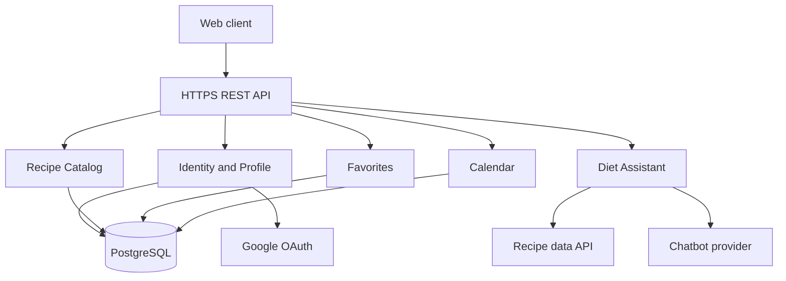
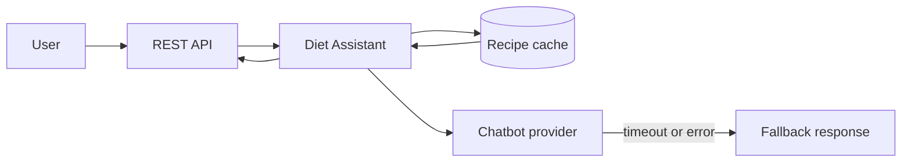

# ADR-002: Modulárny monolit pre RecipeCove

- **Stav:** Proposed
- **Dátum:** 2026-10-31
- **Rozhodnutie:** RecipeCove bude v prvej verzii modulárny monolit s REST API,
  PostgreSQL a samostatnou integračnou vrstvou pre Google OAuth a chatbot.

## Kontext

RecipeCove je webová aplikácia na vyhľadávanie receptov a ingrediencií,
odporúčania podľa diéty, obľúbené recepty a osobný kalendár pripomienok.
Požiadavky obsahujú verejné čítanie receptov, prihlásenie cez Google,
používateľský profil a zmeny osobných kolekcií a kalendára.

Najviac previazané operácie sú autorizované úpravy obľúbených receptov a
kalendára. Zároveň chatbot a externé OAuth API môžu byť dočasne nedostupné.
Požiadavky neuvádzajú extrémnu návštevnosť ani potrebu viacerých vývojových
tímov.

## Zvažované alternatívy

### 1. Modulárny monolit

Jedna aplikácia by obsahovala moduly Identity, Recipe Catalog, Diet Assistant,
Favorites a Calendar a používala by PostgreSQL. Moduly by komunikovali cez
aplikačné rozhrania a nasadzovali by sa spolu.

PostgreSQL by vlastnil profil, recepty, obľúbené recepty a kalendár; REST API
by komunikovalo synchronne a integrácie by boli za adaptérmi. Nasadenie by bolo
jedno. Transakcie by chránili kalendár a obľúbené recepty, zatiaľ čo výpadok
chatbotu alebo OAuth by sa izoloval timeoutom a fallbackom. Náročné by boli
OAuth callbacky, autorizácia vlastníctva a validácia odpovedí chatbotu.
Výhodou je jednoduché testovanie a transakcie pri kalendári a obľúbených
receptoch. Nevýhodou je spoločné škálovanie a spoločný deployment.

### 2. Mikroslužby

Identity, Catalog, Assistant, Favorites a Calendar by boli samostatné služby
s vlastnými dátami. Synchronné API by riešilo čítanie, eventy by propagovali
zmeny receptov a používateľských dát.

Každá služba by vlastnila svoju databázu a služby by sa nasadzovali nezávisle.
Operácie medzi Favorites a Catalog by používali API alebo read model a
konzistentnosť by bola pri eventoch eventual. Výpadok jednej služby by sa
riešil retry, circuit breakerom a cacheou. Náročné by boli Saga workflow pri
zmenách účtu, idempotentné eventy a distribuovaný tracing.
Výhodou je nezávislé škálovanie chatbotu a katalógu. Nevýhodou je distribuovaná
konzistentnosť, zložitejší lokálny vývoj a potreba tracingu, retry a
idempotentných consumerov.

### 3. Serverless/event-driven

API Gateway a cloudové funkcie by obsluhovali jednotlivé use cases, pričom
managed identity, NoSQL databáza a queue by riešili autentifikáciu, dáta a
asynchrónne odporúčania.

Funkcie a managed služby by sa nasadzovali samostatne a komunikovali cez API
a event bus. NoSQL by používala denormalizované read modely, takže kalendár a
obľúbené recepty by mohli byť eventual consistent. Queue a dead-letter queue by
izolovali výpadky chatbotu a importu, no timeouty a cold starts by ovplyvnili
odpoveď. Náročné by boli lokálne testovanie, idempotencia správ a vendor
lock-in.
Výhodou je automatické škálovanie nepravidelných požiadaviek chatbotu.
Nevýhodou sú cold starts, vendor lock-in, zložitejšie vzťahy medzi kalendárom a
obľúbenými receptami a náročnejšie lokálne testovanie.

## Rozhodovacie kritériá

Kritériá sú zoradené podľa priority: kritická, vysoká, stredná a nižšia.

1. **Integrita používateľských dát (kritická):** obľúbené recepty, kalendáre a
   udalosti nesmú patriť nesprávnemu používateľovi ani sa duplikovať.
2. **Bezpečnosť OAuth a osobných údajov (kritická):** tokeny a profilové dáta
   musia byť chránené a každý zápis musí overiť vlastníctvo.
3. **Zložitosť vývoja a prevádzky (vysoká):** riešenie má byť vhodné pre malý
   tím a jednoduché na lokálne spustenie.
4. **Odolnosť externých integrácií (vysoká):** výpadok Google, chatbotu alebo
   zdroja receptov nesmie znefunkčniť uložené dáta.
5. **Jednoduchosť testovania (vysoká):** verejné vyhľadávanie a autorizované
   scenáre musia byť testovateľné bez distribuovanej infraštruktúry.
6. **Nezávislé škálovanie (stredná):** chatbot alebo vyhľadávanie môžu časom
   potrebovať viac kapacity než profil a kalendár.
7. **Prevádzkové náklady (stredná):** prvá verzia nemá vyžadovať veľa managed
   služieb.
8. **Budúca rozšíriteľnosť (nižšia):** hranice modulov majú umožniť neskoršie
   oddelenie chatbotu alebo katalógu.

## Porovnanie alternatív

| Kritérium | Modulárny monolit | Mikroslužby | Serverless/event-driven |
|---|---|---|---|
| Integrita používateľských dát | Vysoká | Stredná | Stredná |
| Bezpečnosť OAuth a osobných údajov | Vysoká | Vysoká | Stredná až vysoká |
| Zložitosť vývoja a prevádzky | Nízka | Vysoká | Stredná |
| Odolnosť externých integrácií | Vysoká | Vysoká | Vysoká |
| Jednoduchosť testovania | Vysoká | Nízka | Nízka až stredná |
| Nezávislé škálovanie | Nízke | Vysoké | Vysoké |
| Prevádzkové náklady | Nízke | Vysoké | Nízke až stredné |
| Budúca rozšíriteľnosť | Stredná | Vysoká | Vysoká |

## Rozhodnutie

Vyberáme modulárny monolit, pretože integrita kalendára, obľúbených receptov a
profilu má vyššiu prioritu než nezávislé škálovanie. Externé služby budú za
adaptérmi s timeoutom, cacheovaním a zrozumiteľnou chybovou odpoveďou.

## Vizuálna architektúra

### Tok odporúčania podľa diéty

## Moduly a hranice

- **Identity and Profile:** OAuth callback, relácie a profil používateľa.
- **Recipe Catalog:** recepty, ingrediencie, vyhľadávanie a verejné čítanie.
- **Diet Assistant:** validácia diéty a adaptér externého chatbotu.
- **Favorites:** vlastnenie a idempotentné ukladanie obľúbených receptov.
- **Calendar:** kalendáre a udalosti používateľa v transakciách.

## Mapovanie požiadaviek

| User stories | Modul | Mechanizmus |
|---|---|---|
| 1, 6-8 | Identity and Profile | OAuth callback, relácia a autorizácia profilu |
| 2-4 | Recipe Catalog | Indexované vyhľadávanie receptov a ingrediencií |
| 5 | Diet Assistant | Validovaný diet filter a izolovaný provider adapter |
| 9-11 | Calendar | Vlastníctvo kalendára, transakcie a index dátumu |
| 12-14 | Favorites | Unikátne `(user_id, recipe_id)` a stránkovanie |

### Mapovanie nefunkčných požiadaviek

| Nefunkčná požiadavka | Architektonická odpoveď |
|---|---|
| Bezpečnosť a súkromie | Google OAuth state/issuer kontrola, HTTPS, autorizácia vlastníctva a žiadne tokeny v logoch |
| Integrita a idempotencia | PostgreSQL transakcie, cudzie kľúče a unikátne obmedzenia |
| Výkon vyhľadávania | Indexy podľa názvu receptu, ingrediencie a stránkovanie |
| Odolnosť integrácií | Adaptéry, timeouty, limitovaný retry, cache a fallback |
| Testovateľnosť a observability | Modulárne hranice, unit/integration testy, korelačné ID a metriky chýb |

## Dáta, bezpečnosť a spoľahlivosť

Tabuľky budú zahŕňať `users`, `recipes`, `ingredients`, `calendars`,
`calendar_events` a `favorite_recipes`. Cudzie kľúče, unikátne obmedzenia a
transakcie zabránia duplicite a poškodeniu väzieb.

OAuth tokeny sa nebudú zapisovať do logov. Callback overí stav a issuer,
endpointy overia reláciu a vlastníctvo kalendára alebo obľúbeného receptu.
Externé volania budú mať timeout, retry s limitom a fallback na uložený obsah.

## Nefunkčné predpoklady

| Predpoklad | Dôsledok | Signál na prehodnotenie |
|---|---|---|
| Katalóg sa v prvej verzii mení dávkovo | PostgreSQL cache je postačujúca | Potreba near-real-time globálneho katalógu |
| Tím je malý | Jeden deployment znižuje prevádzkovú záťaž | Viac tímov vlastní samostatné domény |
| Chatbot je externá integrácia | Assistant má adapter a timeouty | Požiadavka na vlastný model alebo SLA |
| Kalendár nepoužíva multi-device offline sync | Lokálne transakcie postačujú | Konfliktné offline zápisy |

## Dôsledky a budúce prehodnotenie

Získame jednoduchý deployment, silnú konzistentnosť a ľahké integračné testy.
Ak chatbot alebo katalóg dlhodobo preťaží backend, prvým krokom bude vyčlenenie
Assistant alebo Catalog modulu za existujúce rozhranie do samostatnej služby.
Nevýhodou bude spoločné škálovanie a nasadzovanie celého backendu aj pri zmene
jedného modulu. Jedna PostgreSQL databáza môže byť výkonnostným úzkym miestom
a porušenie hraníc modulov môže viesť k silne prepojenému kódu.

## Riziká a zmiernenie

| Riziko | Zmiernenie |
|---|---|
| Výpadok Google OAuth | Timeout, jasná chybová odpoveď a zachovanie existujúcej relácie |
| Nedostupný chatbot | Cache, limitovaný retry a fallback bez blokovania katalógu |
| Neoprávnený prístup ku kalendáru | Kontrola vlastníctva pri každom čítaní a zápise |
| Duplicitné obľúbené recepty | Unikátne databázové obmedzenie a idempotentné endpointy |
| Rast katalógu alebo chatbotu | Indexy, cache a možnosť vyčleniť Catalog alebo Assistant |

## Overenie a budúce prehodnotenie

Testy musia pokryť OAuth callback, expiráciu relácie, cudzie ID kalendára,
duplicitné obľúbené recepty, súbežné úpravy udalostí, nedostupný chatbot a
neplatnú odpoveď externého API. Monitorovať sa má latencia vyhľadávania,
chybovosť OAuth a chatbotu, využitie databázy a počet fallbackov.

Rozhodnutie sa prehodnotí pri potrebe offline synchronizácie kalendára,
viacerých tímov s nezávislým nasadzovaním alebo pri dlhodobom prekročení
kapacity spoločného deploymentu.
